<div align="center">

# 🐢 TAO NGOI (เต่างอย)

**ตู้กดน้ำอัตโนมัติจำลอง เขียนด้วย Java Swing**<br>
**A vending-machine simulator built with Java Swing**


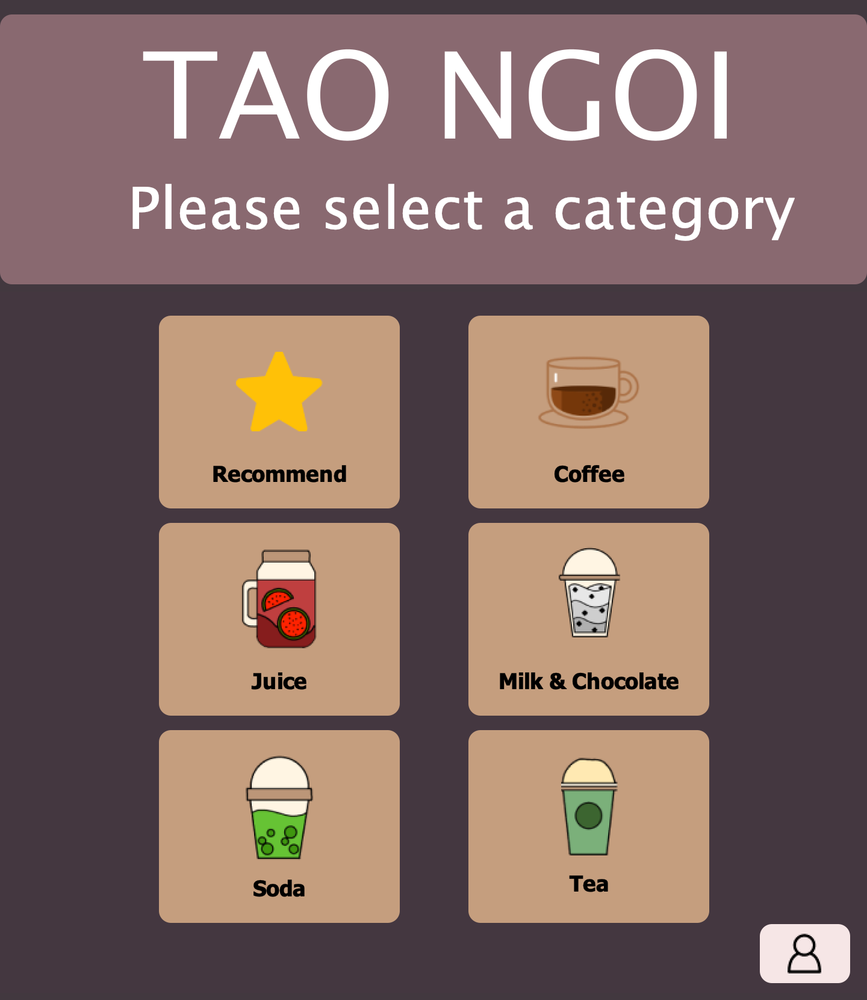
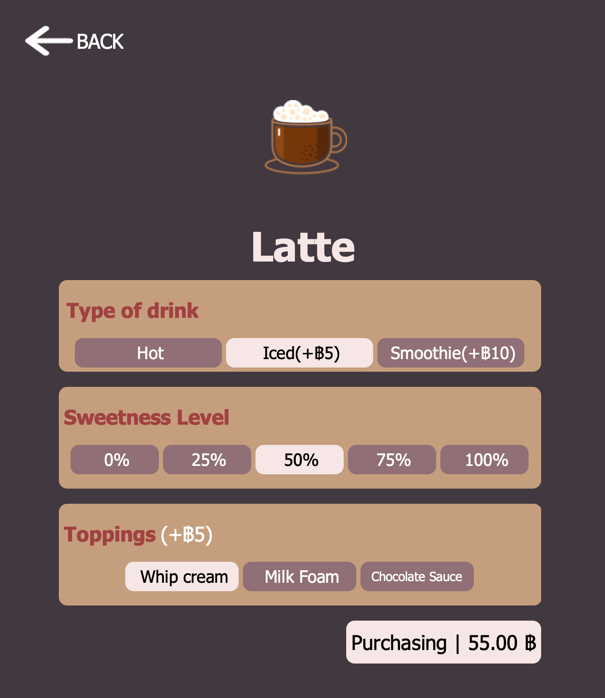
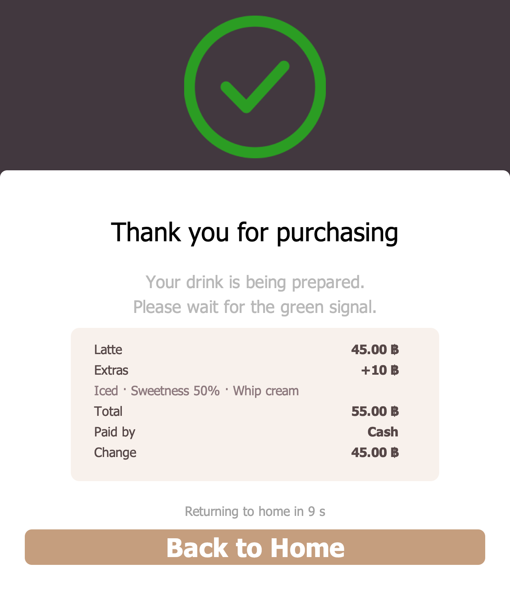

</div>

---

## 📖 สารบัญ · Table of Contents

- [เกี่ยวกับโปรเจกต์ · About](#-เกี่ยวกับโปรเจกต์--about)
- [ฟีเจอร์ · Features](#-ฟีเจอร์--features)
- [ภาพหน้าจอ · Screenshots](#-ภาพหน้าจอ--screenshots)
- [วิธีติดตั้งและรัน · Getting Started](#-วิธีติดตั้งและรัน--getting-started)
- [วิธีใช้งาน · How to Use](#-วิธีใช้งาน--how-to-use)
- [โครงสร้างโปรเจกต์ · Project Structure](#-โครงสร้างโปรเจกต์--project-structure)
- [หลัก OOP ที่ใช้ · OOP Concepts](#-หลัก-oop-ที่ใช้--oop-concepts)
- [สมาชิกในกลุ่ม · Team](#-สมาชิกในกลุ่ม--team)

---

## 🐢 เกี่ยวกับโปรเจกต์ · About

**TH** — ปัจจุบันมีตู้กดน้ำอัตโนมัติอยู่หลายแห่ง โดยเฉพาะในห้างสรรพสินค้า เช่น "ตู้เต่าบิน" ซึ่งได้รับความนิยมมากเพราะราคาไม่แพง เหมาะกับนักเรียนนักศึกษา หลังจากสมาชิกในกลุ่มได้ลองใช้ตู้นี้ เราจึงสนใจว่ามันทำงานอย่างไร และเกิดเป็นโปรเจกต์ **"ตู้เต่างอย"** ที่จำลองการทำงานของตู้กดน้ำ ตั้งแต่เลือกเมนู ปรับแต่งเครื่องดื่ม ชำระเงิน ไปจนถึงระบบหลังบ้านสำหรับผู้ดูแล

**EN** — Automatic drink vending machines are everywhere in Thailand, and *Tao Bin* is one of the most popular because its drinks are cheap enough for students. After trying one, our team wanted to understand how it works, so we built **Tao Ngoi**. It simulates the whole experience: choosing a drink, customising it, paying, and an admin back office to manage products and income.

### 🎯 วัตถุประสงค์ · Objectives

| # | ภาษาไทย | English |
|---|---------|---------|
| 1 | เพื่อเรียนรู้หลักการทำงานของภาษา Java | Learn how the Java language works |
| 2 | เพื่อศึกษาหลักการเขียนโปรแกรมเชิงวัตถุ (OOP) | Study object-oriented programming (OOP) |
| 3 | เพื่อนำความรู้ภาษา Java มาใช้ให้เกิดประโยชน์สูงสุด | Apply Java knowledge to a real project |

### 🌱 ประโยชน์ที่ได้รับ · What We Gained

- ได้เรียนรู้การทำงานเป็นทีม · Teamwork with Git and GitHub
- ได้ศึกษาภาษา Java นอกห้องเรียน · Learning Java beyond the classroom
- ได้ใช้เวลาว่างให้เป็นประโยชน์ · Making good use of free time
- ได้ศึกษาเทคโนโลยีต่าง ๆ · Exploring new technologies (Swing, NetBeans GUI Builder)
- ได้ฝึกทักษะการแก้ปัญหาเฉพาะหน้า · Practising problem solving

---

## ✨ ฟีเจอร์ · Features

### 🧋 ฝั่งลูกค้า · Customer

| ฟีเจอร์ | Feature |
|---------|---------|
| เลือกเครื่องดื่มได้ 5 หมวด: กาแฟ, ชา, นม & โกโก้, น้ำผลไม้, โซดา | Browse 5 categories: Coffee, Tea, Milk & Cocoa, Juice, Soda |
| หมวด **Recommend** แสดง 6 เมนูขายดีที่สุด | **Recommend** shows the 6 best-selling drinks |
| เลือกประเภท ร้อน / เย็น (+5฿) / ปั่น (+5–10฿) | Choose Hot / Iced (+5฿) / Smoothie (+5–10฿) |
| เลือกระดับความหวาน 0% – 100% | Choose sweetness from 0% to 100% |
| เพิ่มท็อปปิ้งได้หลายอย่าง (อย่างละ +5฿) ตามหมวดของเครื่องดื่ม | Add toppings (+5฿ each); the choices depend on the category |
| ราคารวมอัปเดตทันทีเมื่อเลือกตัวเลือก | The total updates as soon as an option changes |
| หน้าชำระเงินแสดงสรุปออเดอร์ (เมนู ตัวเลือก ราคา) | The payment screen shows an order summary (drink, options, total) |
| ชำระเงินด้วย **เงินสด** (มีทอนเงิน), **QR Code** หรือ **TrueMoney Wallet** | Pay by **cash** (with change), **QR code** or **TrueMoney Wallet** |
| ปุ่มธนบัตร **+20 / +50 / +100 / +500 / +1000** กดเพื่อใส่เงินได้เลย | Banknote buttons **+20 / +50 / +100 / +500 / +1000** to insert cash quickly |
| ใบเสร็จหลังชำระเงิน และกลับหน้าแรกอัตโนมัติใน 10 วินาที | A receipt after payment, then back to home automatically after 10 s |
| ไม่มีการใช้งาน 60 วินาทีระหว่างสั่ง จะกลับหน้าแรกเอง | Returns to home after 60 s without activity in the middle of an order |

### 🛠️ ฝั่งผู้ดูแล · Admin

| ฟีเจอร์ | Feature |
|---------|---------|
| แดชบอร์ดแสดงรายได้วันนี้ (Today) และรายได้ทั้งหมด (All time) | Dashboard with today's income and all-time income |
| ตารางยอดขาย เรียงเมนูขายดีไว้บนสุด (คลิกหัวตารางเพื่อเรียงใหม่) | Sales table with best sellers on top (click a header to re-sort) |
| เพิ่ม / แก้ไข / ลบ สินค้า พร้อมอัปโหลดรูป | Add / update / delete products, with image upload |
| บันทึกข้อมูลลงไฟล์ `database.dat` อัตโนมัติ | Data is saved to `database.dat` automatically |

---

## 📸 ภาพหน้าจอ · Screenshots

<table>
  <tr>
    <td align="center"><br><b>หน้าแรก · Home</b></td>
    <td align="center">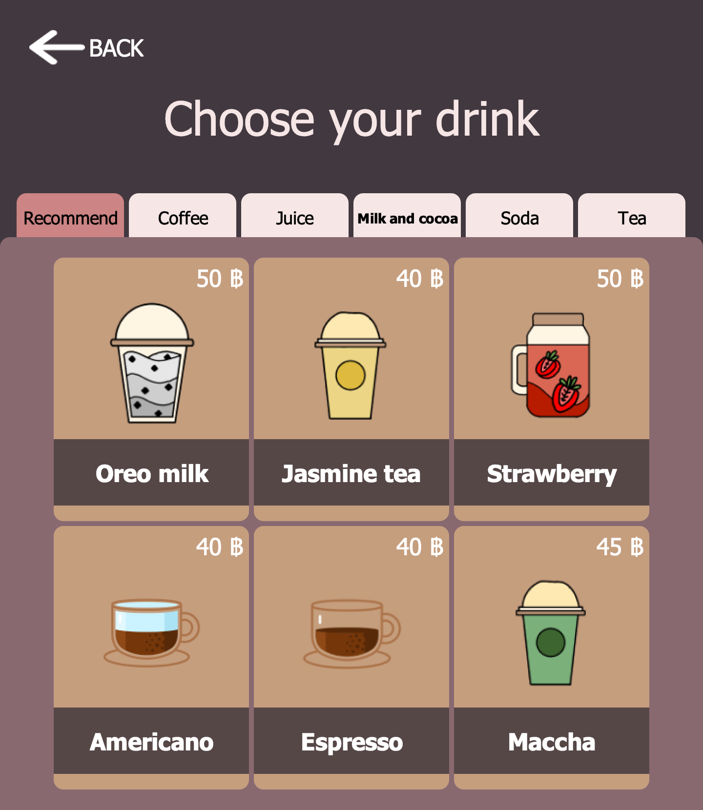<br><b>เมนู · Menu</b></td>
    <td align="center"><br><b>ปรับแต่งเครื่องดื่ม · Customise</b></td>
  </tr>
  <tr>
    <td align="center">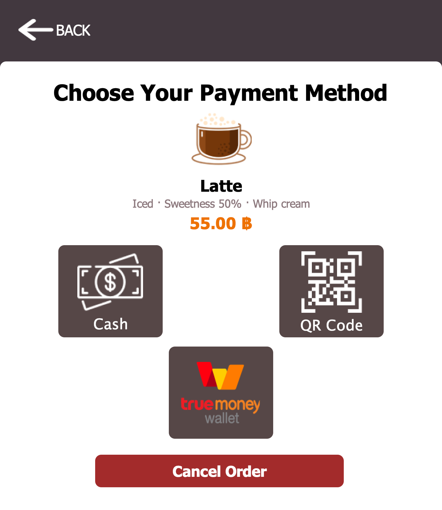<br><b>สรุปออเดอร์ · Order summary</b></td>
    <td align="center">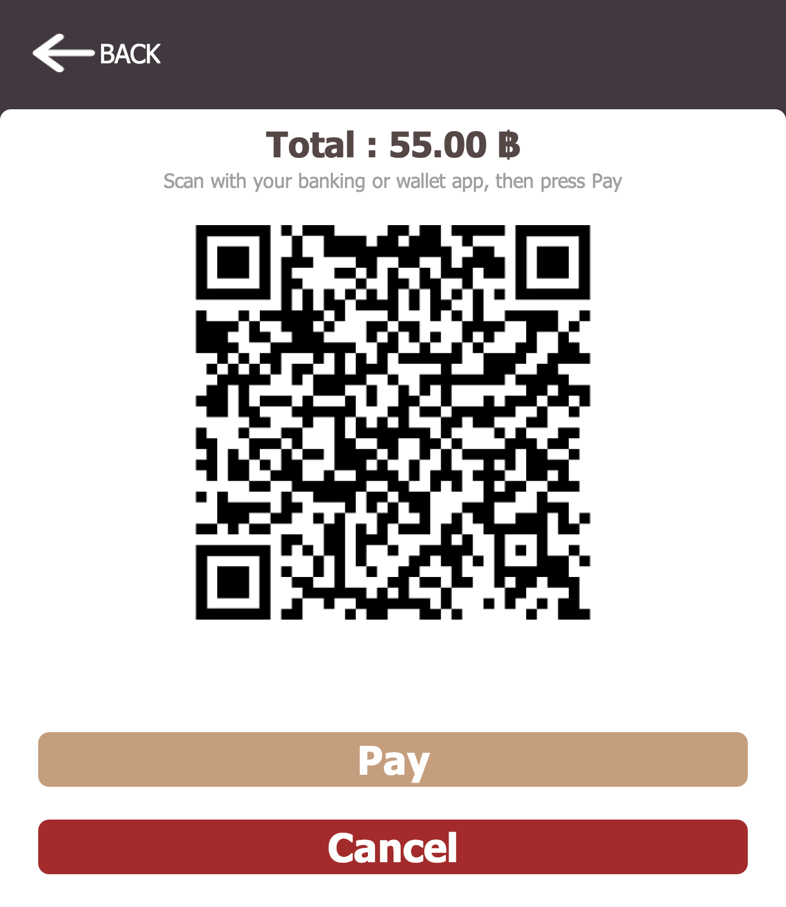<br><b>QR Code</b></td>
    <td align="center">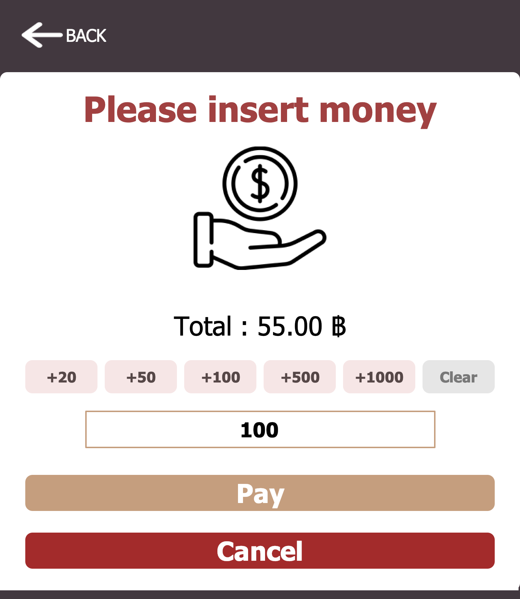<br><b>ใส่เงินสด · Insert cash</b></td>
  </tr>
  <tr>
    <td align="center">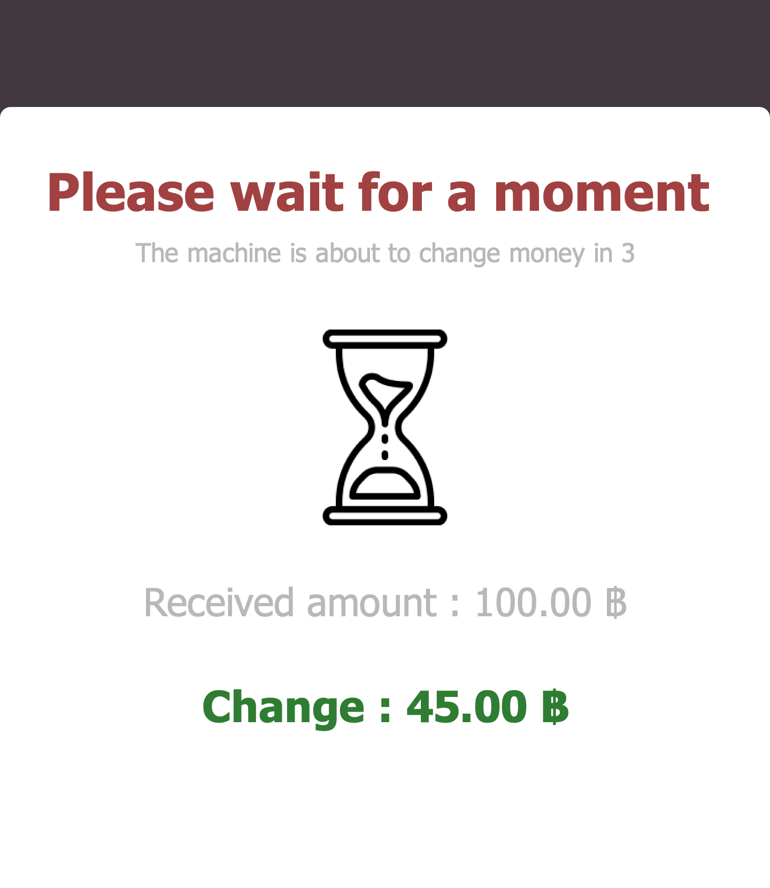<br><b>ทอนเงิน · Change</b></td>
    <td align="center"><br><b>ใบเสร็จ · Receipt</b></td>
    <td align="center">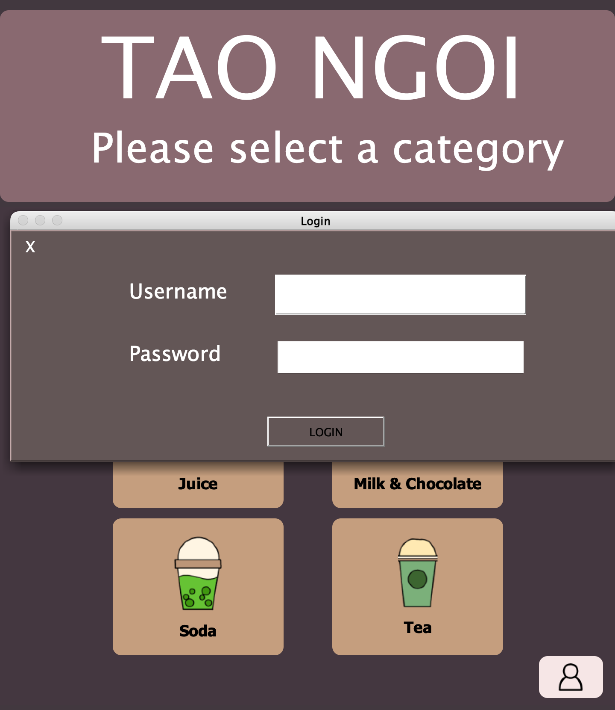<br><b>เข้าสู่ระบบผู้ดูแล · Admin login</b></td>
  </tr>
</table>

<p align="center">
  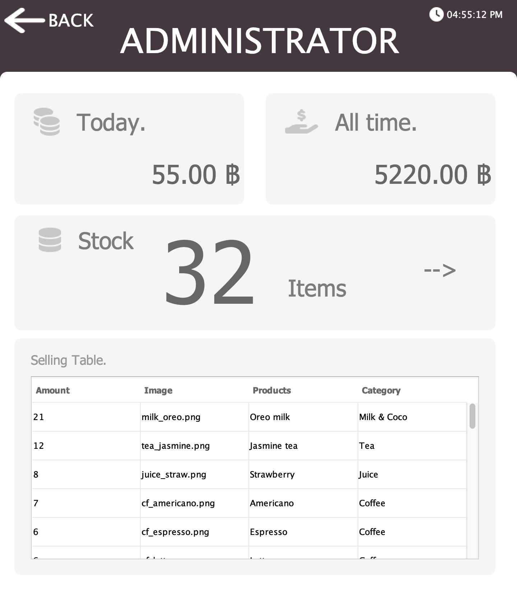<br>
  <b>แดชบอร์ด · Dashboard</b>
</p>

<p align="center">
  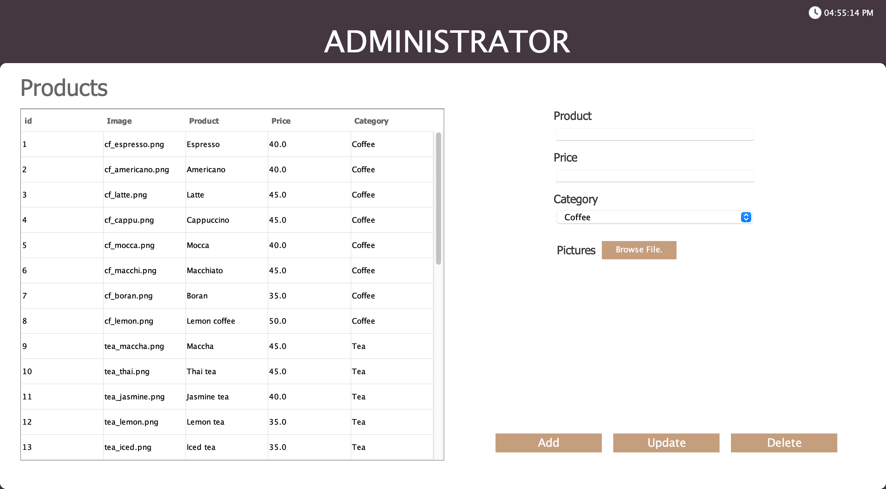<br>
  <b>จัดการสินค้า · Product management</b>
</p>

---

## 🚀 วิธีติดตั้งและรัน · Getting Started

### สิ่งที่ต้องมี · Requirements

- **JDK 17** ขึ้นไป · or newer ([Adoptium](https://adoptium.net/))
- (ไม่บังคับ · optional) **Apache NetBeans** หรือ **IntelliJ IDEA**

### ▶️ วิธีที่ 1: NetBeans (แนะนำ · recommended)

1. `File → Open Project…` แล้วเลือกโฟลเดอร์ `oop_tao` · and choose the `oop_tao` folder
2. กด **Run** (F6) · Press **Run** (F6). The main class is `Controller.AppController`.

### ▶️ วิธีที่ 2: Command line

```bash
git clone https://github.com/madara1150/oop_tao.git
cd oop_tao

# compile
mkdir -p out
javac -encoding UTF-8 -cp lib/absolutelayout/AbsoluteLayout.jar -d out $(find src -name "*.java")

# copy images and icons next to the classes
rsync -a --exclude='*.java' --exclude='*.form' src/ out/

# run (from the project folder, so database.dat is found)
java -cp "out:lib/absolutelayout/AbsoluteLayout.jar" Controller.AppController
```

> 💡 บน Windows ให้ใช้ `;` แทน `:` ใน classpath · On Windows use `;` instead of `:` in the classpath.

---

## 🕹️ วิธีใช้งาน · How to Use

### ลูกค้า · Customer

```
หน้าแรก ─► เลือกหมวด ─► เลือกเมนู ─► ปรับแต่ง ─► ชำระเงิน ─► สำเร็จ
Home    ─► Category  ─► Drink     ─► Options  ─► Payment  ─► Done
```

1. เลือกหมวดเครื่องดื่ม · Choose a category
2. คลิกเมนูที่ต้องการ · Click a drink
3. เลือกประเภท ความหวาน และท็อปปิ้ง แล้วกด **Purchasing** · Pick type, sweetness and toppings, then click **Purchasing**
4. เลือกวิธีชำระเงิน · Choose a payment method
   - **Cash** — กดปุ่มธนบัตร (+20, +50, ...) หรือพิมพ์จำนวนเงิน แล้วกด **Pay** รอนับถอยหลัง 5 วินาทีแล้วกด **Continue** · tap banknote buttons (+20, +50, ...) or type the amount, click **Pay**, wait for the 5-second countdown, then click **Continue**
   - **QR Code / TrueMoney** — ดูยอดที่ต้องจ่าย แล้วกด **Pay** · check the total, then click **Pay**
5. ดูใบเสร็จ แล้วกด **Back to Home** หรือรอ 10 วินาที · Check the receipt, then click **Back to Home** or wait 10 seconds

> 💡 ถ้าลูกค้าเดินออกไประหว่างสั่ง (ไม่มีการใช้งาน 60 วินาที) ตู้จะกลับหน้าแรกเอง · If a customer walks away mid-order (no activity for 60 s), the machine goes back to the home screen.

### ผู้ดูแล · Admin

1. กดปุ่ม 👤 มุมขวาล่างของหน้าแรก · Click the 👤 button at the bottom right of the home screen
2. เข้าสู่ระบบด้วยบัญชีทดลอง (กด Enter ได้) · Log in with the demo account (Enter works too):

   | Username | Password |
   |----------|----------|
   | `madara` | `55555`  |

3. กดการ์ด **Stock** เพื่อเปิดหน้าจัดการสินค้า · Click the **Stock** card to manage products
   - **Add** — กรอกชื่อ ราคา หมวด และเลือกรูป (Browse File) · fill in name, price, category and pick an image
   - **Update** — คลิกแถวในตาราง แก้ไข แล้วกด Update · select a row, edit, then click Update
   - **Delete** — คลิกแถวแล้วกด Delete · select a row, then click Delete

> ℹ️ **Today** คือรายได้ของรอบการเปิดโปรแกรมครั้งนี้ และจะเริ่มที่ 0 ทุกครั้งที่ปิดโปรแกรม ส่วน **All time** คือรายได้สะสมทั้งหมด<br>
> **Today** is the income of the current run and resets to 0 when the app closes. **All time** is the total income ever.

---

## 🗂️ โครงสร้างโปรเจกต์ · Project Structure

```
oop_tao/
├── database.dat                 # ข้อมูลสินค้าและรายได้ · saved products & income
├── lib/                         # AbsoluteLayout.jar (NetBeans layout)
├── docs/screenshots/            # ภาพหน้าจอ · screenshots
└── src/
    ├── Controller/
    │   └── AppController.java   # main() + ควบคุมทุกหน้าจอ · wires all screens (Controller)
    ├── Model/                   # Product, Finance, Stock, Card, Category (Model)
    ├── db/
    │   └── DBModel.java         # โหลด/บันทึกไฟล์ · load/save database.dat
    ├── GUI/                     # หน้าจอทั้งหมด · all screens (View)
    │   ├── MainWindow.java      # หน้าแรก · home
    │   ├── Menu.java            # รายการเครื่องดื่ม · drink list
    │   ├── EachDrink.java       # ปรับแต่งเครื่องดื่ม · drink options
    │   ├── PaymentGUI/          # หน้าชำระเงิน · payment screens
    │   ├── AdminUI/             # แดชบอร์ด/สต็อก · admin dashboard & stock
    │   ├── Components/          # คอมโพเนนต์ที่ใช้ซ้ำ (Table, RoundedLabel, ...) · reusable components
    │   ├── MenuComponent/       # ปุ่มตัวเลือก · option buttons
    │   └── icons/               # ไอคอน · icons
    ├── internal/Login.java      # หน้าต่างเข้าสู่ระบบ · admin login
    ├── util/ProductImages.java  # โหลดรูปสินค้า · loads product images
    └── products/                # รูปเครื่องดื่ม · drink images
```

### สถาปัตยกรรม · Architecture (MVC)

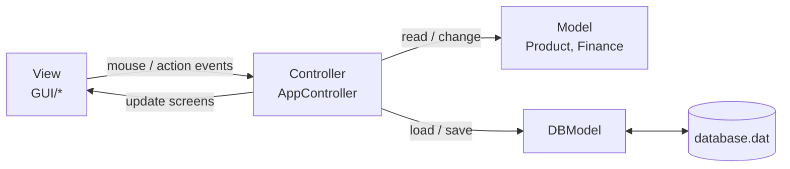

---

## 🧩 หลัก OOP ที่ใช้ · OOP Concepts

| หลักการ · Concept | ตัวอย่างในโปรเจกต์ · Example in this project |
|-------------------|-------------------------------------------|
| **Encapsulation** | `Product`, `Finance` เก็บข้อมูลเป็น `private` และเข้าถึงผ่าน getter/setter · keep fields `private` behind getters/setters |
| **Inheritance** | หน้าจอทั้งหมดสืบทอดจาก `JPanel` / `JFrame` และ `Table` สืบทอดจาก `JTable` · screens extend `JPanel`/`JFrame`, `Table` extends `JTable` |
| **Polymorphism** | Override `paintChildren()` / `paintComponent()` เพื่อวาดมุมโค้ง และ implement `ActionListener` · overriding paint methods for rounded corners, implementing `ActionListener` |
| **Abstraction** | `DBModel` ซ่อนรายละเอียดการอ่าน/เขียนไฟล์ และ `ProductImages` ซ่อนที่มาของรูป · `DBModel` hides file I/O, `ProductImages` hides where images come from |
| **Serialization** | `Product` และ `Finance` implement `Serializable` เพื่อบันทึกลงไฟล์ · saved to `database.dat` |

---

## 👾 สมาชิกในกลุ่ม · Team

| คำนำหน้า | ชื่อ · Name | นามสกุล · Surname | รหัสนักศึกษา · Student ID |
|---------|-------------|-------------------|---------------------------|
| นางสาว | ณุทยา | นิติอภัยธรรม | 64070036 |
| นาย | ธนกร | ศรีวรรณวิทย์ | 64070040 |
| นาย | ธนาธิป | สิงหานนท์ | 64070045 |
| นาย | นรภัทร | ศรีมูลน้อย | 64070054 |
| นาย | ไพรัช | ชื่นชม | 64070081 |

<div align="center">

✨ **06016317 Object-Oriented Programming** ✨

</div>
